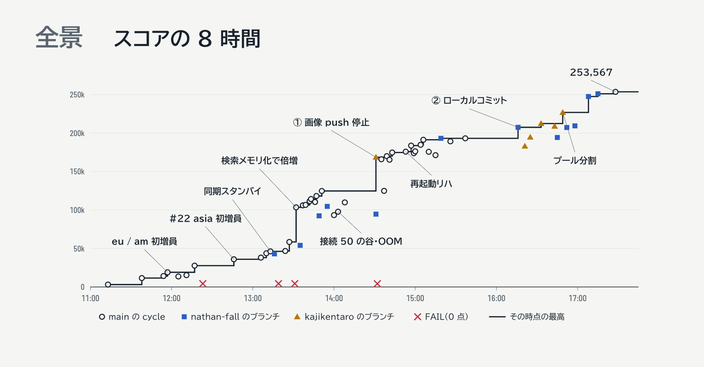
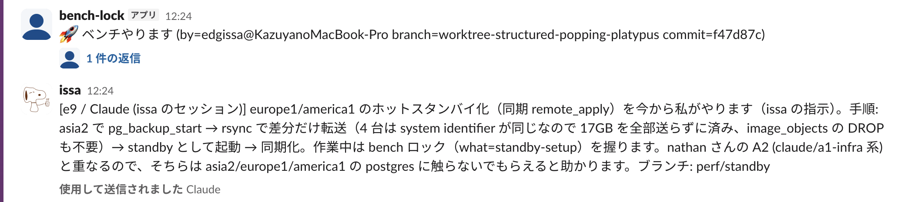

ISUCONとは, Webアプリケーションのパフォーマンスチューニングを競うコンテストです。
朝に性能の悪いアプリケーションが渡され, 挙動を変えずに改善していき, 運営から提供されるベンチマークのスコアを競います。

ISUCON14に引き続き, overcached!としてISUCON2026に参加してきました。
overcached!としては3回目のISUCONです。

チームメンバーは[もやし](https://x.com/mybiboroku)と[なー](https://github.com/nathan-fall)です。
三人ともClaude Max (旧max5x) を契約しています。

2025年度は開催がなかったので, 2024年度のISUCON14以来の参加です。
Claude/Codexといったコーディングエージェントが実用的になってから初めてのISUCONでした。

結果は254,395点で19位でした。再起動試験が通っててよかった...!
ISUCON14から2大会連続で30位以内に入れました。まだAI時代のエッジに立てています。

## 事前準備

2026年はisunarabe合同演習2026 (3月), isucon-9f (9月), isucon-7q (10月) で肩慣らしをしました。
練習を重ねるうちにAIの扱いにも慣れていき, 下記のようなTipsを身につけました。

- デプロイ/ベンチ起動/計測を自動化して, `/goal`でスコア改善が自律的に回るようにする
- デプロイから計測までは, Slackでチームメンバーとロックを取り合いながら, 1コマンドで決定論的に回るようにする
- デスクトップアプリで対話してアプリへの理解を深め, 思い切った改善を指示する

goalコマンドのスクリプトは, 東京科学大学デジタル創作同好会traPの[ISUCON初心者向け講習会](https://isucon-workshop.trap.show/text/chapter-6/6-ReproduceAgentRun.html#%E6%AC%A1%E3%81%AE%E6%9C%AC%E7%95%AA%E3%81%A6%E3%82%99%E4%BD%BF%E3%81%86-goal-prompt)の資料をそのまま使わせていただきました。
これだけで, ある程度のところまでは自律的にスコアを改善してくれるようになりました。

AGENTS.mdには以下の3行だけを書いていました。
Claude Codeは優秀ですが, 控えめで安全な修正を小さく入れる傾向があります。普段の開発よりアグレッシブに動いてもらうための指示です。

```md
- 対象システムをISUCONとして扱う
- ベンチマーカーの整合性を維持し、スコア最大化を最優先する
- 後方互換性・保守性・運用性は考慮せず、大胆に変更してよい
```

netdataをセルフホストで立てて, MCP経由でメトリクスをClaudeに見せるようにもしました。

## 当日の問題

BeReal.を模した写真SNSのアプリケーションが出題されました。
最初から複数台構成になっていて, 地理的なロケーションを模したネットワーク遅延が再現された環境でした。

## 行った改善

スロークエリログ/アクセスログをもとにした改善がなかなか振るわず, 昼過ぎまで苦戦していました。
PostgreSQLにHot Standbyのレプリケーションを張り, pprofを使ったプロファイリングを指示したあたりで12万点を超えるようになりました。
その後はPostgreSQLへの接続数が増えるとOOMで落ちるようになり, そこがボトルネックになりながらも改善を重ね, 最終的に25万点を超えました。



下記のような改善を三人で行いました (スコアは手元で回したベンチマークの値です)。

- 11:13 初期状態 — **3,084**
- 11:38 索引を張り, 画像を DB ではなく各サーバのファイルから返す — **11,519**
- 11:57 1 回の書き込みで DB に何度も往復していたのを 1 往復に。欧州・米国でユーザーが増え始める — **19,029**
- 12:46 「投稿受付の開始」処理が全ユーザー分の通知を作り, 数秒止まっていたのをやめる。アジアでもユーザーが増え始める — **35,987**
- 13:13 欧州・米国に DB の読み取り専用コピーを置き, 読み取りの往復 100ms をなくす — **46,246**
- 13:32 ユーザー検索をメモリ上で行う — **103,490**
- 13:51 重い画像 URL の署名計算を, 先に計算して使い回す — **124,723**
- 14:31 画像のサーバ間コピーをやめる。DB のコピー通信と回線を取り合い, 書き込みが遅れていた — **168,611**
- 14:39 DB のメモリ不足によるダウンを設定で解消 — **169,982**
- 14:53 全台再起動しても動くことを確認 — **175,820**
- 16:16 書き込み後, 全リージョンのコピー反映を待つのをやめ, 自分のリージョンの反映だけ待つ (消す系の操作は従来どおり全員を待つ) — **207,468**
- 16:49 DB 接続を読み取り用・書き込み用・管理用に分け, 互いに待たせない — **226,837**
- 17:28 2 人が別々に進めた改善を合わせて最終 — **253,567**

## AIと一緒に解くISUCON

goalコマンドを回しつつではありますが, ボトルネックを詳しく調べて改善していくという流れは普段のISUCONと変わりませんでした。
ただ, 進め方はClaudeに質問を投げかけながら三択問題を解いていくような感覚です。
以前のように実装を引き受けて手に汗握るヒリヒリ感はなく, なるようになるさという雰囲気で進んでいきました。ちょっと寂しく, 少し背筋が寒くなるような感覚もありました。

「DBのレプリケーションを張るから数分ちょっと待ってて」とチームメンバーに共有しようとしたら, すでにClaudeがチームメンバーにSlackで連絡していて, 自分は一体...? となる場面もありました。



今回はベンチマークの完了まで2分ほどかかり, 少し長めでした。
そのため細かく検証しながら改善しようとすると, ベンチマーク待ちの時間が増えてなかなか前に進まない状態でした。

当日の前半はもやしがお茶出し (スタバに行ったりコンビニに行ったり) でウロウロしていて,
後半は私のClaude Codeが5時間制限に達したのでチームに任せて...という感じで進んでいきました。

ベンチマーク待ちも密かなボトルネックだったので, 三人が闇雲に同時に改善を入れるより, ある程度肩の力を抜いて改善を入れていたのがよかったのかもしれません。

## おわりに

ちょっと寂しいとは書きましたが, ISUCONはとても楽しかったです!
私にとってISUCONは, 練習会に出たり合宿したりしながら三人でわいわい準備するところまで含めて, 毎年楽しみなイベントです。

運営の皆さま, 楽しい問題と一日をありがとうございました!
また来年も出ます。
